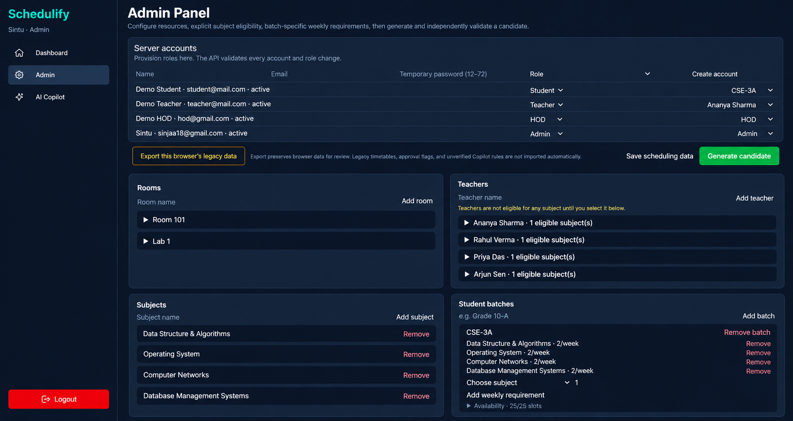
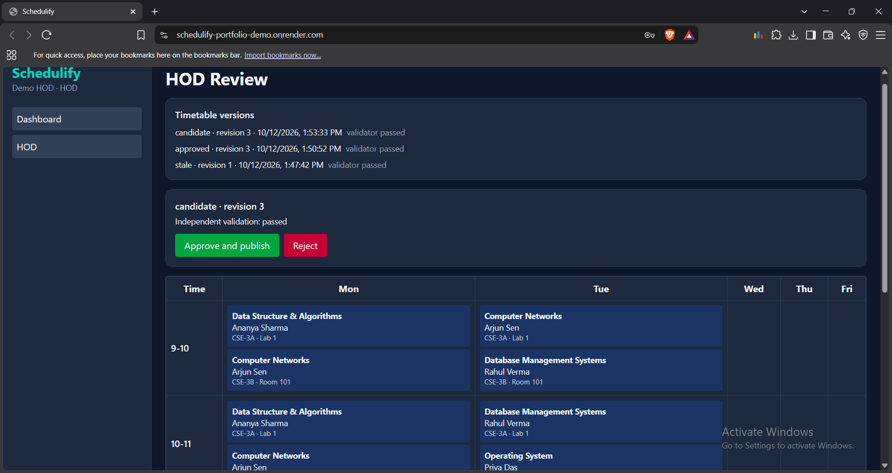
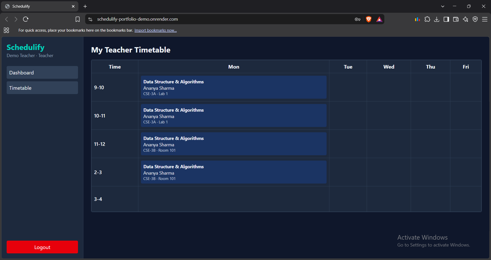
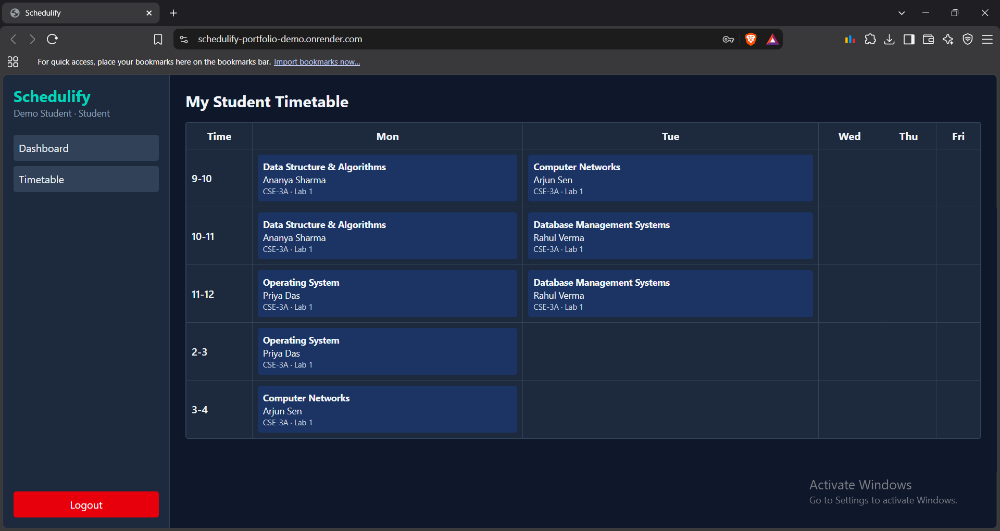
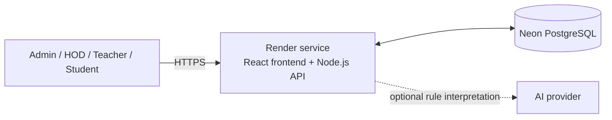

# Schedulify

**A constraint-aware timetable scheduling platform** built with React, Node.js, and PostgreSQL.

[Live demo](https://schedulify-portfolio-demo.onrender.com) · [Source code](https://github.com/sinjaa18/Schedulify) · [CI workflow](https://github.com/sinjaa18/Schedulify/actions/runs/38218428908)

Schedulify helps institutions create weekly timetables while respecting subject requirements, teacher eligibility, availability, and room conflicts. It generates a candidate, validates it independently, and requires approval from a Head of Department (HOD) before publication.

> **Demo notice:** The hosted app is for portfolio demonstration using fictional data. The free hosting tier may sleep when idle. Do not use it for real student information or critical timetabling. Managed backup and recovery have not been verified.

## Features

- **Scheduling configuration:** Manage batches, subjects, rooms, teachers, teacher eligibility, availability, and weekly session requirements.
- **Constraint-aware generation:** Generate complete schedules with deterministic search and backtracking.
- **Independent validation:** Check generated assignments for collisions, eligibility, availability, and exact weekly requirements.
- **HOD approval:** Review and publish valid schedules. Changes to scheduling inputs can make older candidates stale.
- **Role-based access:** Separate Admin, HOD, Teacher, and Student workflows.
- **Optional AI Copilot:** Convert natural-language preferences into structured rules for an administrator to review and confirm. AI does not assign classes or approve a timetable.

## Screenshots

### Admin configuration

Manage rooms, teachers, subjects, and the subjects each teacher is eligible to teach.



### HOD review and publication

The HOD reviews the candidate and its validation status before publication.



### Teacher timetable

Teachers can view the timetable associated with their linked teacher account.



### Student timetable

Students see the timetable for their linked batch.



## How it works

1. **Configure:** Add batches, subjects, rooms, teachers, eligibility, availability, and weekly session counts.
2. **Generate:** The scheduler expands each weekly requirement into individual session tasks and searches for valid placements.
3. **Validate:** An independent validator checks the candidate against the scheduling data and constraints.
4. **Review:** An HOD reviews the candidate. Approval revalidates it against the current revision so a stale candidate cannot be published.
5. **Publish and view:** The published timetable is available through the appropriate Teacher and Student views.

## Scheduling approach

The scheduler uses a deterministic constraint-search algorithm:

- **Minimum Remaining Values (MRV):** Choose the unassigned session with the fewest available placements first.
- **Backtracking:** Explore alternate placements when a choice prevents the remaining sessions from fitting.
- **Load-aware ordering:** Prefer placements that help distribute classes across available slots.
- **Bounded search:** Node and time limits help prevent a difficult scheduling case from running indefinitely.
- **Independent validation:** Verify the resulting assignments instead of trusting the search result alone.

The goal is to find a valid timetable, not to prove that it is globally optimal. Worst-case search time can be exponential. Infeasible, invalid, and search-limit outcomes are reported separately rather than presented as successful schedules.

## Architecture



The frontend and API share one HTTPS origin. The API handles authentication, authorization, scheduling, validation, and publication. PostgreSQL stores accounts, scheduling resources, rules, timetable versions, and approval history. AI interpretation is optional; manual scheduling works without an AI provider key.

## Tech stack

| Area | Technologies |
|---|---|
| Frontend | React 19, Vite, Tailwind CSS |
| Backend | Node.js API, server-side sessions, role-based authorization |
| Database | PostgreSQL and SQL migrations; Neon for the hosted demo |
| Scheduling | Deterministic constraint search, MRV, backtracking, load-aware ordering |
| Testing | Unit tests, PostgreSQL integration tests, Playwright/Chromium E2E, ESLint |
| Deployment | Render + Neon; Docker/Nginx configuration is also included for self-managed hosting |

## Live demo and health checks

- **Application:** [schedulify-portfolio-demo.onrender.com](https://schedulify-portfolio-demo.onrender.com)
- **Readiness check:** [/api/health/ready](https://schedulify-portfolio-demo.onrender.com/api/health/ready)
- **Liveness check:** [/api/health/live](https://schedulify-portfolio-demo.onrender.com/api/health/live)
- **Hosted CI:** [View GitHub Actions run](https://github.com/sinjaa18/Schedulify/actions/runs/38218428908)

The deployed service uses Render and Neon PostgreSQL. A database check confirmed a validated 16-assignment candidate and an HOD-approved timetable for the current scheduling revision, with zero reported validation violations. The hosted CI workflow passed for the deployment-ready code. These checks do not establish production-scale reliability or verify managed backup recovery.

## Run locally

### Requirements

- Node.js 20.19+ or 22.12+
- npm
- PostgreSQL 14+ (or a dedicated development database)

### Setup

1. Create a PostgreSQL database named `schedulify` and a role with access to it.
2. Copy `.env.example` to `.env` and set `DATABASE_URL`. Keep credentials out of Git.
3. Install dependencies and apply migrations:

   ```bash
   npm install
   npm run db:migrate
   ```

4. Create the first administrator:

   ```bash
   npm run auth:bootstrap
   ```

   Follow the prompts. The command refuses to create another initial Admin after one already exists.

5. Start the API and frontend in separate terminals:

   ```bash
   npm run dev:api
   npm run dev
   ```

6. Sign in as Admin. Use **Server accounts** to create HOD, Teacher, and Student accounts. Link Teacher accounts to teacher records and assign Student accounts to batches.

The AI Copilot is optional. Set `OPENAI_API_KEY` only in the server environment to enable provider-backed interpretation. Never expose database credentials or provider keys through `VITE_*` variables.

## Tests and verification

Quick local checks:

```bash
npm run test:unit
npm run lint
npm run build
```

For the full suite, configure `.env.test` using `.env.test.example`, ensure Docker and Playwright Chromium are available, and set the isolated `TEST_DATABASE_URL` and `E2E_DATABASE_URL` values. Then run:

```bash
npm run verify
```

The test runners use isolated test schemas and include safeguards to prevent tests from running against the live demo database. Do not point test database variables at production data. The hosted CI workflow runs unit tests, lint, PostgreSQL integration tests, dependency audit, browser E2E tests, and the production build.

## Performance snapshot

In a local synthetic benchmark with 96 assignments, median generation time decreased from **4.53 seconds to 0.73 seconds**—about **84% lower**—after grouped MRV candidate counting.

Reproduce the benchmark with:

```bash
node scripts/benchmark-scheduler.mjs
```

This is a local benchmark result, not a production throughput or scalability guarantee. Benchmark performance depends on the scheduling constraints and input size.

## Security and limitations

- Public registration is disabled. Admins create accounts and assign roles.
- Passwords are bcrypt-hashed. Session and CSRF tokens are stored as digests.
- State-changing requests require CSRF and same-origin checks.
- Teacher and Student access is derived from server-side account links.
- Search is synchronous, and worst-case scheduling time is exponential.
- The scheduler finds a valid candidate; it does not guarantee a globally optimal timetable.
- Login rate limiting is per API process.
- Managed backup schedules, point-in-time recovery, restore drills, and production-scale reliability are not verified.
- Use fictional data in the hosted demo.

## Resume summary

**Schedulify — Constraint-Aware Timetable Scheduling Platform**

- Built a PostgreSQL-backed timetable platform with Admin, HOD, Teacher, and Student workflows, persisted timetable versions, and revision-checked publication.
- Implemented deterministic constraint search using MRV and backtracking, followed by independent validation of generated schedules.
- Added an optional AI Copilot that maps administrator preferences to reviewable scheduling rules without delegating class assignment or approval decisions to AI.
- Reduced median generation time by about 84% on a synthetic 96-assignment benchmark through grouped MRV candidate counting.

## Documentation

- [Architecture guide](./ARCHITECTURE.md)
- [Deployment guide](./DEPLOYMENT.md)
- [Source repository](https://github.com/sinjaa18/Schedulify)


