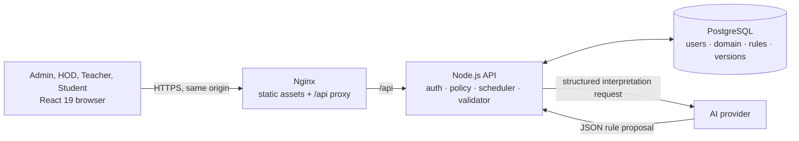

# Schedulify

Schedulify addresses the constraint-heavy work of building a weekly timetable: meeting exact class requirements while respecting teacher eligibility, room and batch availability, and collision rules. It is a full-stack timetable application built with React 19, Vite, a Node.js API, and PostgreSQL. The server owns identity and timetable state; deterministic search generates candidates, an independent validator checks them, and an HOD controls publication.

### Project highlights

- Manage batches, subjects, rooms, teacher eligibility, availability, and exact weekly session requirements.
- Generate complete schedules with a deterministic constraint-search algorithm; reject incomplete or invalid candidates.
- Translate administrator preferences with an AI Copilot into reviewable scheduling rules. The model proposes rules but does not create assignments or approve schedules.
- Persist accounts, scheduling data, timetable versions, and approval history in PostgreSQL, with server-side role checks for Admin, HOD, Teacher, and Student workflows.
- Serve the React app and Node API on one origin, with PostgreSQL and provider credentials kept server-side.

See [Architecture](./ARCHITECTURE.md) for runtime boundaries and data flow, and [Deployment](./DEPLOYMENT.md) for the prepared production topology and its verification status.

## Domain model

- `subject`, `teacher`, `room`, and `batch` records have stable IDs and names.
- Each batch owns `requirements: [{ id, subjectId, weeklySessions }]`; session counts are batch-specific.
- Teachers explicitly list `subjectIds`. The scheduler does not infer eligibility from names.
- Batches, teachers, and rooms carry `availableSlots`, an allowlist of `day|slot` values. New resources default to all 25 weekday slots (Mon–Fri; 9–10, 10–11, 11–12, 2–3, 3–4). The Admin UI can edit these allowlists.
- An assignment stores batch, subject, teacher, room IDs and readable names, day, slot, and requirement ID.

The Admin UI can export known legacy localStorage keys to JSON. Legacy data is not read as current state or auto-imported. Review resource names and stable IDs, then enter canonical resources through the Admin UI. Old schedules and approval flags are not trusted; generate a fresh candidate. Legacy global subject frequency is not copied into batch-specific requirements.

## Scheduling and validation

`src/utils/scheduler.js` is a React/provider-independent deterministic constraint search. It expands exact weekly counts into session tasks, selects the remaining task with the fewest currently available placements (MRV), and backtracks over stable slot, teacher, and room order. MRV counts feasible assignments from per-slot teacher and room groups, avoiding a full scan of every teacher-room pair. Occupancy keys and teacher-period occupancy are precomputed/maintained so the inner search does not rebuild keys or scan all prior assignments. A complete candidate is checked by the independent validator before it is returned. It never returns a partial schedule as success. The finite search remains exponential in the worst case.

Results expose `status`: `feasible`, `infeasible`, `invalid_input`, `search_limit`, `cancelled`, or `invalid_candidate`. Capacity, eligibility, and exhausted-search proofs report infeasibility; malformed or unsupported input reports `invalid_input`. `maxNodes` defaults to one million, `maxDurationMs` can set a time limit, and an already-aborted `AbortSignal` returns `cancelled`. Because the current scheduler is synchronous, mid-run cancellation from a UI requires moving search to a worker; the time and node limits work during the synchronous search. Search-limit and cancelled results contain no timetable, and search state is unwound before returning. A `feasible` result means a valid schedule was found; the soft-rule ordering is not a proof of global optimality.

Hard constraints enforced by generation:

1. One class per batch, teacher, and room in each day/time slot.
2. Explicit teacher-subject eligibility.
3. Exact weekly requirement counts.
4. Batch, teacher, and room slot availability.
5. Confirmed, supported Copilot hard rules.

Supported Copilot rules are: keep a day/period free for a batch (or all batches), require a subject in the morning (or prefer it there), and avoid adjacent slots for a teacher. Morning adjacency does not cross the lunch break. Unsupported or clarification-needed confirmed rules block generation. The three soft-rule types rank otherwise valid placements; this is a deterministic first-feasible heuristic, not a global optimization guarantee. Unmet soft preferences are reported separately and do not invalidate hard constraints.

`src/utils/validator.js` independently inspects assignment rows and domain data for missing resources, invalid/unavailable slots, batch/teacher/room collisions, ineligible teachers, unrequired classes, exact weekly counts, and unsupported or violated Copilot constraints. Only a non-empty schedule that passes this validator can be approved. HOD approval repeats validation against current data. Hard-rule violations prevent approval.

The AI only interprets language into the confirmed rule schema. The API validates output against its database-backed resource catalog. Confirmed supported rules are persisted with the confirming administrator and revision. The deterministic scheduler applies the rules and the independent validator checks assignments. AI never creates timetable rows or decides validity.

## Authentication and accounts

The API owns identity. Emails are trimmed and lowercased, unique in PostgreSQL, and passwords are stored as bcrypt hashes (cost 12; passwords must be 12–72 UTF-8 bytes to avoid bcrypt input truncation). Roles are `Admin`, `HOD`, `Teacher`, or `Student`; request bodies cannot choose a role during signup. Public registration is disabled so every account and Student batch association is administrator controlled. Admins provision other accounts and change roles through the Admin panel. Changing a role revokes that account's sessions; an administrator cannot remove their own Admin role, and the last active Admin cannot be demoted.

The server issues opaque random session cookies. Only SHA-256 digests of session and CSRF tokens are persisted. Cookies are `HttpOnly`, `SameSite=Lax`, scoped to `/`, and expire after 12 hours. Set `COOKIE_SECURE=true` in production behind HTTPS. State-changing API calls require the matching session CSRF token and same-origin `Origin`; set `PUBLIC_APP_ORIGIN` to the exact public origin when a reverse proxy changes the request host. Login failures use a generic message and are rate limited to ten attempts per IP per minute per API process.

Server policy protects account provisioning, resource and rule mutations, generation, HOD approval, and own/assigned timetable reads. Teacher and Student scopes derive from persistent account links.

## Deploy a portfolio demo

A no-Docker deployment recipe for a public React + Node app with PostgreSQL is in [DEPLOYMENT.md](./DEPLOYMENT.md#portfolio-demo-deployment-render--neon). The included Render Blueprint serves frontend assets and /api/* from one origin; Neon supplies PostgreSQL. Passing CI verifies code checks; it does not itself mean a live deployment exists.

## Run locally

Requires Node.js 20.19+ or 22.12+, npm, and PostgreSQL 14+ (local installation or a dedicated development database).

1. Create an empty PostgreSQL database named `schedulify` and a dedicated database role with access only to that database.
2. Copy `.env.example` to `.env`; set `DATABASE_URL` to the local connection string. Optionally set server-side `OPENAI_API_KEY` for AI interpretation. `.env` is ignored by Git.
3. Run `npm install`, then `npm run db:migrate` to apply SQL migrations.
4. Run `npm run auth:bootstrap` in a terminal to create the initial administrator. The command prompts for name and email and does not echo the password. It refuses to create another Admin if one already exists.
5. Start the API with `npm run dev:api` and Vite with `npm run dev` in separate terminals. Vite proxies `/api` to the local API.
6. Sign in as the provisioned Admin. Use **Server accounts** in the Admin panel to create HOD, Teacher, Student, or additional Admin accounts, then link Teacher accounts to teacher records and assign Students to batches. Manage resources and generate candidates from the Admin panel; HOD accounts review and publish candidates.

Without a provider key, manual scheduling still works. `API_PORT` (default 3001), `OPENAI_API_URL`, and `OPENAI_MODEL` are optional server variables. `DATABASE_SSL=true` enables verified PostgreSQL TLS. Never put database or provider credentials in `VITE_*` variables. If the database is unavailable or `DATABASE_URL` is unset, auth calls fail closed; the server does not create ephemeral users.

For administrator recovery, use the database operator account and a reviewed one-time SQL transaction to promote a known account after verifying its identity; remove the temporary SQL/artifact afterward. Do not add a default password or public bootstrap route.

## Checks and benchmark

- `npm test` runs HTTP-boundary authentication tests against an isolated fake repository, plus Copilot, migration, scheduler, validator, and approval-gating tests. Auth tests do not require a real database and do not verify PostgreSQL connectivity or production migration execution.
- `npm run build` builds the client.
- `node scripts/benchmark-scheduler.mjs` runs one warm-up and nine measured repetitions for each deterministic synthetic case, reports the median and nearest-rank p95, and validates each returned schedule. Set `BENCH_WARMUPS` and `BENCH_REPEATS` to change the run counts. The expected feasibility of the tight case is known by construction: 50 assignments fit into 13 slots with four rooms (52 simultaneous room places), seven teachers, and ten available slots per batch.
- To compare search variants on that tight fixture in PowerShell: `$env:BENCH_CASE='resource-tight-feasible'; $env:BENCH_VARIANTS='baseline,least_loaded,forward_check,combined'; $env:BENCH_WARMUPS='1'; $env:BENCH_REPEATS='5'; node scripts/benchmark-scheduler.mjs`.

The original benchmark measured one call per Node process. Six baseline processes were run and the first was discarded; the optimized comparison used the same process-per-sample approach, with five samples summarized by median and maximum (the p95 estimate for five samples). On Windows 10, Node v22.18.0, AMD Ryzen 7 7730U, the original vs optimized results were:

| Case | Assignments | Baseline median / p95 | Optimized median / p95 | Change | Nodes before → after | Validator |
|---|---:|---:|---:|---:|---:|---|
| Small (2 batches × 3 subjects × 2) | 12 | 45.06 / 45.63 ms | 40.32 / 40.65 ms | −10.5% | 12 → 12 | Pass |
| Moderate (8 × 6 × 2) | 96 | 4,526.78 / 4,550.58 ms | 729.76 / 734.65 ms | −83.9% | 96 → 96 | Pass |

The expanded suite used one warm-up and nine measured calls in one process. Measurements below are generation time; validation is independently run on every candidate. `—` means no complete candidate existed to validate. `candidateChecks` counts calls that evaluate a representative teacher-room choice during MRV plus full candidate checks for the selected task.

| Case | Size (batches / teachers / rooms / available slots per batch) | Assignments | Median / p95 | Nodes / backtracks / max depth | Outcome | Validator |
|---|---|---:|---:|---:|---|---|
| Small feasible | 2 / 4 / 3 / 25 | 12 | 9.65 / 13.57 ms | 12 / 0 / 11 | Feasible | Pass |
| Moderate feasible | 8 / 12 / 8 / 25 | 96 | 689.65 / 771.26 ms | 96 / 0 / 95 | Feasible | Pass |
| Resource-tight feasible¹ | 5 / 7 / 4 / 13 | 50 | 40.62 / 82.50 ms | 50 / 38 / 49 | Feasible | Pass |
| Insufficient batch slots | 1 / 1 / 1 / 1 | 2 | 0.01 / 0.03 ms | 0 / 0 / 0 | Proven infeasible | — |
| Missing eligible teacher | 1 / 1 / 1 / 25 | 1 | 0.02 / 0.03 ms | 0 / 0 / 0 | Proven infeasible | — |
| Availability vs exact count | 1 / 1 / 1 / 10 | 2 | 0.07 / 0.17 ms | 1 / 1 / 0 | Proven infeasible | — |
| Conflicting hard day-off rules | 1 / 1 / 1 / 25 | 1 | 0.14 / 0.19 ms | 1 / 0 / 0 | Proven infeasible | — |
| Near-boundary feasible | 1 / 1 / 1 / 10 | 10 | 1.09 / 1.24 ms | 10 / 0 / 9 | Feasible | Pass |

¹ The 50-assignment case is feasible by construction: assigning batch `b`, task `j` to slot `(10b + j) mod 13` gives each batch ten unique slots and no slot more than four classes, matching room capacity. The default adaptive strategy solves it within the 25,000-node limit. Its forward check runs only for resource-tight domains. The moderate case evaluates about 1.46 million `allowed()` calls, down from 11.40 million before grouped MRV; grouped counting folds available room choices together. The stable node count shows the Phase 3 speedup came from cheaper MRV work rather than less search.

The Phase 4 strategy comparison uses the same tight fixture and node budget (25,000), one warm-up and five measured calls. For five samples the reported p95 is the maximum, so treat it as a tail estimate rather than a stable service-level statistic.

| Strategy | Median / p95 | Nodes / backtracks | Candidate checks | Forward checks / prunes | Outcome / validator |
|---|---:|---:|---:|---:|---|
| Stable ordering, no forward check | 159.54 / 211.91 ms | 25,000 / 24,957 | 472,834 | 302,404 | 0 / 0 | Search limit / — |
| Least-loaded slot ordering | 35.54 / 37.34 ms | 88 / 38 | 109,090 | 12,740 | 0 / 0 | Feasible / Pass |
| Forward checking only | 4,753.33 / 4,906.93 ms | 25,000 / 779,714 | 11,955,678 | 8,313,572 | 779,756 / 754,756 | Search limit / — |
| Combined | 39.23 / 51.18 ms | 50 / 38 | 116,658 | 12,740 | 88 / 38 | Feasible / Pass |

Least-loaded ordering alone cuts the search from 25,000 nodes to 88 and finds a valid timetable. Forward checking alone regresses badly because it recomputes every requirement’s remaining slot capacity after each candidate; it still hits the limit. Combined with the ordering heuristic, forward checking prunes 38 failed branches before deeper search and reduces nodes to 50, with a modest median-time increase over ordering alone.

These synthetic inputs are not a throughput or scalability guarantee. A custom solver remains appropriate for the current JavaScript-only deployment, simple hard rules, and first-feasible objective. OR-Tools is implemented in C++ and its official repository lists wrappers for Python, C#, and Java; using it here would add a language/runtime boundary without a matched experiment demonstrating enough benefit ([official installation guide](https://developers.google.com/optimization/install), [official repository](https://github.com/google/or-tools)). If future requirements add global optimization or larger tightly constrained instances, compare against CP-SAT on equivalent data and independently validate its assignments. The next highest-impact work is stronger safe feasibility bounds and candidate ordering for resource-tight feasible instances, measured against a constructed schedule such as the 50-assignment case.

## Verification commands

Requires Node.js 20.19+ or 22.12+, npm, and PostgreSQL 14+ for the server. Playwright E2E requires Chromium. Docker Compose is an optional way to start a dedicated local PostgreSQL test database.

```powershell
Copy-Item .env.test.example .env.test
docker compose -f compose.test.yml up -d --wait
npm ci
npx playwright install chromium
npm run test:unit
npm run lint
npm run test:db
npm run test:e2e
npm run build
# Or run all verification steps in sequence:
npm run verify
docker compose -f compose.test.yml down -v
```

The local test service listens only on loopback port 55432 and uses test-only credentials. Its configuration is separate from `.env`. The PostgreSQL and E2E runners require explicit URLs ending in `_test`, compare them with `DATABASE_URL`, verify the connected database name, create an unpredictable per-run schema, and drop only that schema. PostgreSQL tests use actual migrations, API routes, and transactions; they do not fall back to a fake database. Set `TEST_DATABASE_URL` and `E2E_DATABASE_URL` in `.env.test`; both can use the disposable database shown in `.env.test.example`.

- `npm test` / `npm run test:unit`: local HTTP-boundary/auth, Copilot, health, scheduler, and validator tests; no PostgreSQL required.
- `npm run lint`: ESLint checks the application and server scripts.
- `npm run test:db`: real PostgreSQL integration suite. It fails if the explicit test database is absent or unsafe.
- `npm run test:e2e`: Chromium browser tests against Vite, the actual Node API, and an isolated PostgreSQL schema. Test identities and deterministic Copilot results exist only in that schema; no live AI key is needed.
- `npm run build`: root-path static production build used by the Nginx deployment image.
- `npm run verify`: unit + lint + PostgreSQL + E2E + production build. It expects both test URLs and Chromium to be configured.

GitHub Actions in `.github/workflows/ci.yml` runs unit tests, lint, PostgreSQL 18 integration tests, a full dependency audit, Chromium E2E, and the build. It preserves browser traces on failure. CI has read-only repository permissions and uses disposable test credentials. The hosted run for pre-fix commit `93edbc3e80b6706485179d97c7c25bcd807bf213` failed in E2E because Tailwind's PostCSS dependency was missing. The dependency/configuration correction described in this repository passed local verification; a hosted run for the corrected snapshot is still required. CI does not deploy production.

The former GitHub Pages publisher was removed because a static-only host cannot serve the authenticated API. Legacy Pages build workflows do not verify the Node/PostgreSQL application. No remote Pages settings are changed by this repository.

## API operations and security

`GET /api/health/live` checks process liveness. `GET /api/health/ready` checks PostgreSQL with `SELECT 1`; `/api/health` aliases readiness. Health responses expose only dependency state. The API validates startup environment, enforces a 2 MB request body limit and HTTP/database timeouts, closes the HTTP server and pool on SIGINT/SIGTERM, and avoids returning database details to clients. Same-origin `/api` routing is supported; permissive CORS is not enabled. Production startup requires `COOKIE_SECURE=true` and an HTTPS `PUBLIC_APP_ORIGIN`.

The browser never receives `DATABASE_URL`, session secrets, or `OPENAI_API_KEY`. Keep the provider key on the API host. Serve the frontend and API on one HTTPS origin so HttpOnly Secure cookies, SameSite=Lax, and CSRF Origin/token checks work together. Restrict database ingress to the API host and require TLS for remote PostgreSQL.

## Deployment topology

See [DEPLOYMENT.md](./DEPLOYMENT.md) for the provider-neutral production environment, release, health-check, and recovery checklist.

`Dockerfile.api`, `deploy/Dockerfile.web`, `deploy/nginx.conf`, and `compose.release.example.yml` prepare a static React/Nginx service that proxies `/api` to Node. PostgreSQL is an external persistent managed service; the compose example deliberately does not create a production database. TLS should terminate at a managed ingress/load balancer in front of the web service. Only the web service should be externally reachable; keep the API and PostgreSQL private. Node and Nginx base images use explicit patch and Alpine release tags; the Compose test database and CI use PostgreSQL 18.6 to match the locally exercised server version.

On the deployment host, copy `.env.production.example` to the ignored `.env.production` file and set real host values. Build the services and apply migrations before switching traffic:

```sh
docker compose -f compose.release.example.yml build
docker compose -f compose.release.example.yml run --rm api node server/migrate.mjs
docker compose -f compose.release.example.yml run --rm -it api node scripts/bootstrap-admin.mjs
docker compose -f compose.release.example.yml up -d
```

Set `PUBLIC_APP_ORIGIN` to the exact HTTPS browser origin, `COOKIE_SECURE=true`, and `DATABASE_SSL=true` when required by the managed database. Use an API-only least-privilege role; never use a database owner credential for the application. Run migrations as a controlled release step after a backup, not automatically on each API startup. Check readiness and complete an Admin login after deployment. This configuration has been prepared locally; no image or live service has been deployed or verified.

## Backup and recovery

Use the PostgreSQL provider's encrypted automated backups or point-in-time recovery, restrict restore access to database operators, and store exported custom-format archives in encrypted access-controlled storage. A practical initial policy is 14 daily restore points plus a pre-migration backup; adjust retention to the service recovery objectives. Backups and retention are not configured by this repository.

For a manual custom-format archive, configure a protected libpq service entry and password file (`PGSERVICEFILE` / `PGPASSFILE`; on Windows use PostgreSQL's `pgpass.conf` and restrictive file ACLs). Avoid putting database passwords in shell arguments or logs:

```sh
pg_dump --format=custom --no-owner --no-privileges --dbname="service=schedulify-backup" --file=schedulify.dump
pg_restore --list schedulify.dump > /dev/null
createdb --service=schedulify-admin schedulify_restore_test
pg_restore --exit-on-error --no-owner --no-privileges --dbname="service=schedulify-restore-test" schedulify.dump
psql "service=schedulify-restore-test" -c "select count(*) from schema_migrations;"
```

Restore into a fresh disposable database, check the migration table and known record counts, point a staging app at it, and run health and integration checks before a controlled recovery cutover. Keep the previous API image and restore into a new database if a migration release fails. Do not test restore or cleanup commands against a live database. A local PostgreSQL 18.6 custom-format dump was restored into a separate disposable database; verification found both migration rows and the seeded Admin fixture. This does not verify a managed-provider recovery or point-in-time restore.

## Workflows and limitations

Scheduling data, Copilot rules, candidates, published versions, and approval history are server-authoritative. Admin edits are sent as atomic validated domain snapshots with optimistic revisions. Generation reads canonical data, runs the deterministic scheduler and independent validator, and persists only complete candidates. HOD approval revalidates stored assignments inside a locked transaction. Data changes mark earlier versions stale while retaining history. Legacy browser exports can be reviewed and manually reconciled; old schedules and approval flags are not imported or trusted.

The browser journey configures batches, subjects, teachers, rooms, requirements, and eligibility in the Admin UI; confirms a supported Copilot rule through a deterministic provider fixture; handles missing and malformed provider responses; generates and validates; rejects a stale candidate; exercises HOD rejection and publication; and checks scoped Teacher/Student views even with forged query parameters. Additional browser cases verify revoked sessions cannot read protected data, API-unavailable messaging, injected database connection failure and recovery, and infeasible generation feedback. Unit and PostgreSQL tests also cover expired sessions, readiness failures, authorization, rejected transitions, and persistence. These are local E2E results, not CI or live-deployment results. No live provider key was used.

Remaining limitations include synchronous search (no mid-search cancellation), exponential worst-case scheduling time bounded by node/time limits, per-process login rate limiting, no automated legacy-data import, and no production deployment or managed backup configuration. The unused GitHub Pages publisher and its vulnerable development-only dependency chain were removed because authenticated API routes require the documented Nginx-to-Node topology. After removal, `npm audit` reports no dependency vulnerabilities. The next highest-impact improvement is a provider-backed staged deployment with managed backups and a scheduled restore drill.

## Portfolio walkthrough

### Problem and architecture

Schedulify addresses the work of building a conflict-free weekly timetable from batch-specific subject counts, teacher eligibility and availability, room capacity, and administrator preferences. It persists each version and requires a Human-in-the-Loop (HOD) approval before publication.



### Engineering decisions

- **Scheduling:** The deterministic search expands each batch requirement into exact session tasks. It selects the task with the fewest valid placements (MRV), orders candidate slots by load, and applies forward checking to tight remaining domains. Search has node/time bounds and reports infeasible, invalid, limited, or feasible distinctly. A feasible result is first-fit, not a proof of global optimality.
- **Independent validation:** The validator checks persisted assignments against the current resource catalog, exact weekly requirements, availability, collisions, eligibility, and confirmed hard rules. It does not reuse the scheduler's search decisions.
- **Approval and persistence:** PostgreSQL transactions persist candidate rows and approval events. HOD approval reloads and validates the stored assignments while locking the source revision; a changed revision rejects the stale candidate. A uniqueness constraint permits one current publication.
- **Copilot:** The provider converts natural language into a bounded structured rule proposal against a server-side catalog. Administrators review and confirm supported rules. The model never creates assignments or approves a schedule.
- **Security:** The API owns account roles and identity links. Opaque sessions and CSRF checks protect writes; Teacher and Student reads derive identity from the authenticated account. Database and provider credentials remain server-side.

### Screenshots

There are no genuine application screenshots in the repository yet. Capture these manually from a running app with disposable demo data and accounts; use fictional names and avoid real credentials or student information:

1. Admin domain setup showing batches, requirements, teacher eligibility, rooms, and availability.
2. AI Copilot rule review showing a natural-language request and the structured rule awaiting confirmation.
3. Generated timetable candidate with its independent validation result visible.
4. HOD review showing candidate details and the publication action or published status.
5. Teacher or Student view showing the authenticated, scoped timetable.

Use screenshots from the actual application only. Add them under a repository image directory and link them here with relative paths after capture.

### Demonstration plan

1. Start the disposable PostgreSQL service, configure `.env` and `.env.test`, apply migrations, and provision an Admin using the documented commands.
2. In the browser, add two batches, subjects, teachers, rooms, weekly requirements, eligibility, and availability. Refresh and show the persisted domain.
3. Ask Copilot for a supported hard rule, review and confirm the structured result, then generate. Show the persisted candidate and independent validation.
4. Change a scheduling input and show that the earlier candidate is stale. Generate again and have an HOD reject one candidate and publish another.
5. Sign in as linked Teacher and Student accounts. Show each assigned view and the API’s resistance to forged batch/teacher query IDs.
6. Run `npm run verify` to show automated unit, lint, real PostgreSQL, and browser checks. The E2E harness uses a deterministic provider fixture; no live provider key is needed.

Use the E2E journey above as a repeatable demonstration script. Capture portfolio images only from a separately prepared demo database and browser session.

### Interview talking points

1. The initial scheduler did not model batch-specific exact demand, explicit teacher eligibility, or availability, so it could not reliably produce a complete valid week.
2. MRV chooses the most constrained remaining session; load-aware ordering and forward checking improve search on measured resource-tight cases.
3. The independent validator checks schedule invariants from saved rows instead of trusting the search result.
4. Revision locks and transactional approval prevent publication after scheduler inputs change and serialize concurrent approvals.
5. The Copilot parses preferences into reviewable rules; deterministic code owns placement and correctness.
6. Server-side roles and database identity links determine who can manage or read each schedule.
7. Nginx serves static assets and proxies a same-origin API, while Node and PostgreSQL remain private behind the public web entry point.
8. Limitations include first-feasible search, exponential worst-case runtime, synchronous execution, process-local login throttling, and no live infrastructure or managed backup verification.

### Resume project entry

**Schedulify — Constraint-Aware Timetable Scheduling Platform**

*React 19, Vite, Node.js, PostgreSQL, Playwright, Docker, GitHub Actions*

- Built a PostgreSQL-backed scheduling platform with role-scoped Admin, HOD, Teacher, and Student workflows, persistent timetable versions, and revision-checked publication.
- Implemented deterministic constraint search using MRV, load-aware ordering, and forward checking, followed by independent validation of generated schedules.
- Added an AI Copilot that maps administrator language to confirmed scheduling rules; locally verified with 35 unit tests, 2 PostgreSQL integration tests, 3 Chromium E2E journeys, lint, production build, and a zero-vulnerability dependency audit.

On a synthetic 96-session benchmark, grouped MRV candidate counting reduced median runtime from 4.53 s to 0.73 s (about 84%). This fixture result is not a production throughput or scalability guarantee.
